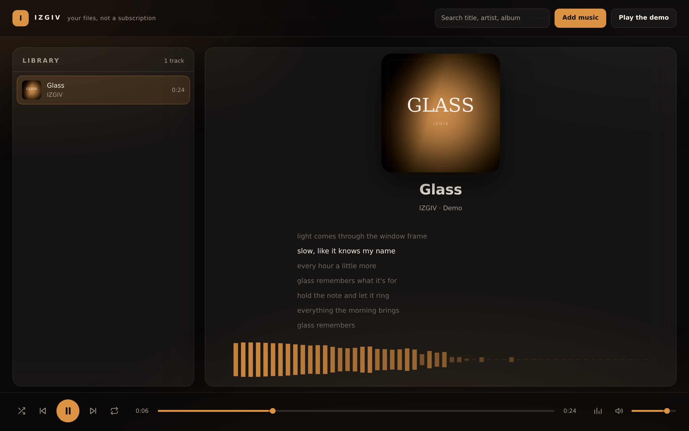

# Waxwing

**A crate-digger that plays.** Type a name — hear it: full-length concerts and
Creative Commons records from the Internet Archive, Apple's official
30-second previews of the mainstream catalogue, your own files, YouTube —
one queue, one page. Nothing is uploaded, there is no account, and there is
nothing to install.

[**Open the player →**](https://aryanrajmaurya.github.io/waxwing/)



## Why this exists

The first IZGIV was an Electron app. It had the warm glass, the equaliser and
the cover-derived colour, but getting it running meant a native build and a
lockfile that resolved a `git+ssh` dependency — which fails on any machine
without a GitHub key. An installer that breaks is a hard thing to hand to
someone who just wants to hear an album.

This is the remake. The parts people actually used are here; the parts that
made it fragile are gone. There is no sidecar process, no native module and no
build step — the whole player is static files, so any static host will serve
it.

## What it does

- **Resolves any link through song.link (Odesli).** The *Add link* button
  takes any music URL — YouTube Music, Apple Music, Spotify, song.link share
  links — and Odesli's public API reports the same song across platforms.
  From that one mapping the player offers every route it honestly can: the
  official Apple preview, full-length archive.org recordings, and the
  YouTube embed — pick one and cue it. When song.link is unreachable it
  falls back to searching the pasted text.
- **Finds the song, from sources that are theirs to give.** Type into the
  search box and both find-sources answer at once:
  - **Internet Archive** — full-length recordings: the Live Music Archive
    (thousands of concert recordings the performers themselves released),
    Creative Commons uploads, and a century of pre-copyright wax. The best
    audio file is picked per item — never a 300 MB FLAC between someone and
    a song — and it streams full-length.
  - **iTunes** — the mainstream catalogue, as Apple itself grants it: the
    official 30-second preview, real artwork and metadata, and a link to
    where the song is sold. A refresh on what wax is, not a replacement for
    buying it.
  Deliberately not built: scraping download rips of the mainstream catalogue.
  The previews and the Archive require no key and no scraping, and a player
  built on someone else's stolen files isn't worth the domain it runs on.
- **Plays the files you drop on it.** MP3, FLAC, OGG, Opus, M4A, WAV — whatever
  the browser can decode. The picker, drag-and-drop and a folder-sized drop all
  work.
- **Plays YouTube, inside YouTube.** Press the *YouTube* button and paste a
  link (or an id): the video plays in the art frame in YouTube's own embed,
  joins the queue with local tracks, and its title and channel are fetched
  from YouTube's oEmbed endpoint — no key involved. Honest limits: the audio
  never leaves YouTube's player, so the equaliser and the spectrum (which work
  by routing the sound through the Web Audio graph) don't apply to YouTube
  tracks. Lyrics still follow the clock.
- **Reads the tags, including the cover.** Title, artist, album, track, year
  and genre come out of the file, and the embedded picture becomes the artwork
  and the source of the accent colour. No tag? The filename is split into
  artist and title instead.
- **Follows `.lrc` lyrics.** Drop a `.lrc` next to its audio (or into the same
  drop) and the lines scroll in time, with the active line lifted out. Multiple
  timestamps per line, `[offset:]` and the `[ti:]`/`[ar:]` headers are handled.
- **Ten-band equaliser.** 32 Hz to 16 kHz, with flat/warm/vocal/night presets
  and a preamp that moves opposite to the largest boost so nothing clips.
- **Shuffle that doesn't repeat itself.** Tracks are shuffled into a bag and
  every track plays once before any plays twice, the way a shuffle is supposed
  to work. Repeat can be off, all or one.
- **A visualiser that reads like a spectrum.** 56 logarithmically spaced bands
  from 40 Hz to 14 kHz, drawn from the analyser after the EQ.
- **Remembers your settings.** Volume, EQ, shuffle and repeat survive a reload.
- **Works offline.** A service worker caches the shell, so the player opens
  without a network. Your music is never cached — it is your file, not ours.

### Keyboard

| Key | Action |
|---|---|
| `Space` | Play / pause |
| `←` `→` | Seek 5 seconds |
| `n` / `p` | Next / previous track |
| `m` | Mute |
| `e` | Equaliser |

## How it works

Nothing is bundled. The modules are plain ES modules loaded by the browser:

| File | Job |
|---|---|
| `src/tags.js` | ID3v2.2 / v2.3 / v2.4 reader — text frames and `APIC` cover art |
| `src/lrc.js` | `.lrc` parser: timestamps, offsets, multiple stamps per line |
| `src/color.js` | Dominant colour from the cover, lifted into a readable accent |
| `src/eq.js` | The ten filters, presets, and the preamp calculation |
| `src/queue.js` | Play order, shuffle bag, repeat, previous/next |
| `src/yt.js` | YouTube URLs → video id, the IFrame API contract |
| `src/wax.js` | The two find-sources: iTunes (JSONP) and archive.org (search, metadata, file choice) |
| `src/app.js` | The UI, the Web Audio graph and the playback loop |

Three decisions worth knowing about:

**Tags are read from the first megabyte.** A 60 MB FLAC should not be read into
memory to show a title. ID3 tags live at the front of the file, so the player
slices a megabyte, parses that, and hands the whole file to the audio element as
an object URL.

**The accent is not the average colour.** Averaging a cover lands on mud,
because most covers are mostly one dull background. The parser buckets pixels
by hue, scores each bucket by how saturated it is and how much area it covers,
and takes the winner. The result is then moved in HSL — not scaled — until it
reads on a near-black page.

**The visualiser is log-spaced.** Linear FFT bars spend their first three bars
on the bass and leave the rest dark. Hearing is logarithmic, so the bars are
too: each bar owns every bin between its lower and upper edge.

## Formats and tags, honestly

- **Tags:** MP3 via ID3v2 (v2.2, v2.3, v2.4), including embedded JPEG and PNG
  cover art.
- **FLAC, OGG, Opus, M4A, WAV:** these play, but their tags are not parsed yet,
  so the title comes from the filename. FLAC and Vorbis comments are the
  obvious next addition.
- **Browser support:** current Chrome, Edge, Firefox and Safari. The player
  needs ES modules, the Web Audio API and object URLs, all of which have been
  available for years.

## Run it locally

There is no build step and there are no dependencies.

```bash
git clone https://github.com/AryanRajMaurya/izgiv
cd izgiv
python3 -m http.server 8000 --bind 127.0.0.1
# open http://127.0.0.1:8000
```

A server is required: browsers refuse to load ES modules from `file://`, and
the demo track and service worker are fetched over HTTP.

## Tests

```bash
npm test
```

The pure modules — tags, lyrics, colour, EQ, queue — run under `node --test`
with no framework and no dependencies. CI also boots the page in headless
Chrome and fails if it does not reach `data-ready="ready"` with the demo loaded,
because unit tests cannot tell you that a page is blank.

## The demo track

The demo, *Glass*, is generated rather than sampled: `demo/make-demo.mjs`
synthesises four chords, a bass, a bell arpeggio and some filtered air, writes a
WAV, and the README in that file shows the one `ffmpeg` command that muxes it
with the cover into `demo/demo.mp3`. No sample licences, and the file is
reproducible byte for byte.

## License

MIT — see [LICENSE](LICENSE).
